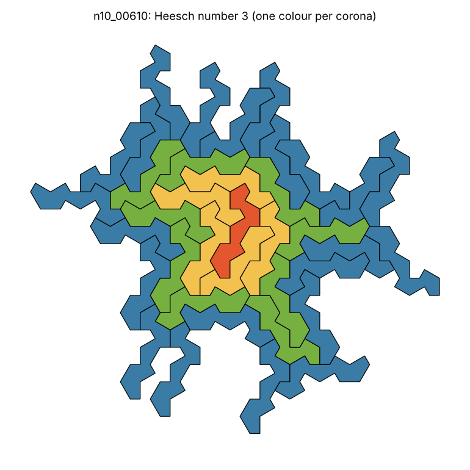
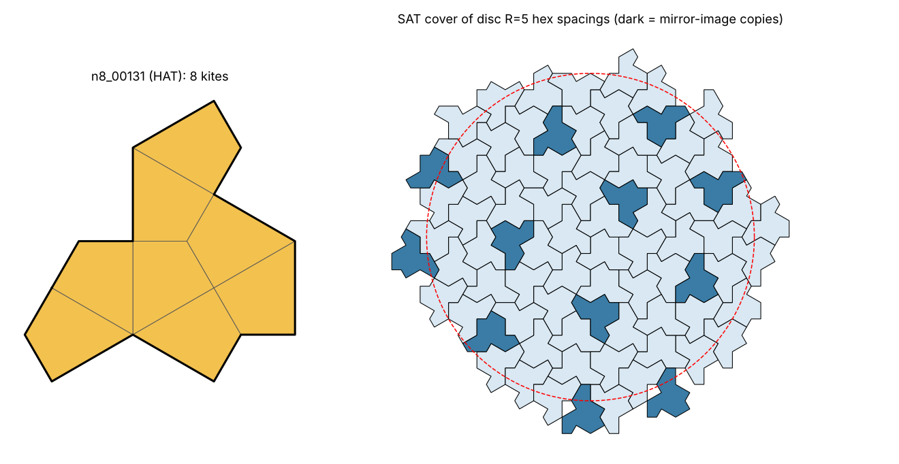
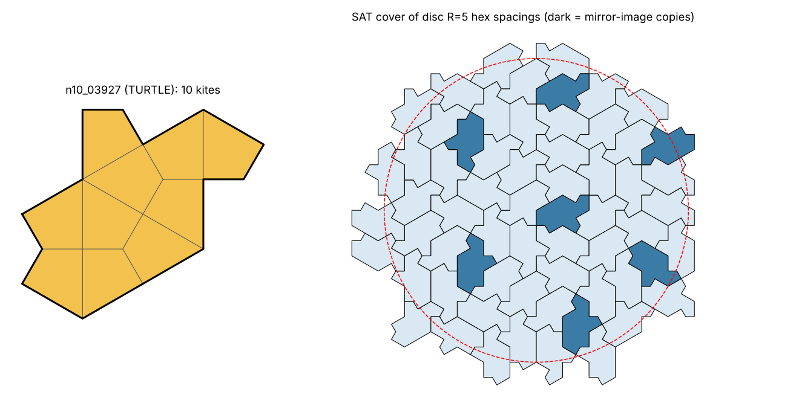

# Results

"candidate" = covers every disc up to the radius cap, but **no periodic (torus) tiling found up to the cap**. It is not a proof of aperiodicity; see README.md.

Caps: torus fundamental domain <= 12 tiles; disc radius <= 6 hexagon spacings; Heesch tested up to 5 coronas. All placements on the kite grid.

| n | shapes | does not tile | tiles periodically | candidate | Myers: tilers / non-tilers | match | wall time |
|---|---|---|---|---|---|---|---|
| 1 | 1 | 0 | 1 | 0 | 1 / 0 | yes | 0.0s |
| 2 | 2 | 1 | 1 | 0 | 1 / 1 | yes | 0.0s |
| 3 | 4 | 0 | 4 | 0 | 4 / 0 | yes | 0.0s |
| 4 | 10 | 5 | 5 | 0 | 5 / 5 | yes | 0.0s |
| 5 | 27 | 26 | 1 | 0 | 1 / 26 | yes | 0.4s |
| 6 | 85 | 14 | 71 | 0 | 71 / 14 | yes | 0.6s |
| 7 | 262 | 207 | 55 | 0 | 55 / 207 | yes | 3.8s |
| 8 | 873 | 833 | 39 | 1 | 40 / 833 | yes | 25.0s |
| 9 | 2917 | 2162 | 755 | 0 | 755 / 2162 | yes | 36.9s |
| 10 | 10011 | 9996 | 14 | 1 | 15 / 9996 | yes | 262.6s |

"match" compares (periodic + candidate, does-not-tile) with Joseph Myers' independent counts (his tiler count includes the hat at n=8 and the turtle at n=10).

## Heesch numbers of the non-tilers

| n | H=0 | H=1 | H=2 | H=3 | H=4 | H=5 |
|---|---|---|---|---|---|---|
| 1 | 0 | 0 | 0 | 0 | 0 | 0 |
| 2 | 1 | 0 | 0 | 0 | 0 | 0 |
| 3 | 0 | 0 | 0 | 0 | 0 | 0 |
| 4 | 4 | 1 | 0 | 0 | 0 | 0 |
| 5 | 12 | 14 | 0 | 0 | 0 | 0 |
| 6 | 13 | 1 | 0 | 0 | 0 | 0 |
| 7 | 165 | 41 | 1 | 0 | 0 | 0 |
| 8 | 720 | 108 | 5 | 0 | 0 | 0 |
| 9 | 2093 | 69 | 0 | 0 | 0 | 0 |
| 10 | 9404 | 579 | 12 | 1 | 0 | 0 |

Highest Heesch number found: 3 (n10_00610).
Heesch here forbids holes in every corona (Kaplan's H_c). The values are not compared with any published polykite table; each corona structure is re-checked by independent code.

## Candidates

### n8_00131 (8 kites) — **the hat**
Covers discs up to R=6; no torus tiling with <= 12 tiles per fundamental domain.

### n10_03927 (10 kites) — **the turtle**
Covers discs up to R=6; no torus tiling with <= 12 tiles per fundamental domain.

## How the caps affect the result

Every shape that tiles periodically was found with a fundamental domain of at most the number of tiles below, and every non-tiler failed at the disc radius below. A shape becomes a (false) candidate if the torus cap is below the tiles it needs, or if the disc cap is below the radius at which it fails.

| n | most tiles per period needed | largest failing disc radius |
|---|---|---|
| 1 | 6 | - |
| 2 | 3 | 1.5 |
| 3 | 2 | - |
| 4 | 6 | 1.5 |
| 5 | 6 | 3 |
| 6 | 12 | 2 |
| 7 | 6 | 4 |
| 8 | 6 | 4 |
| 9 | 6 | 3 |
| 10 | 6 | 5 |

Shapes needing 12 tiles per period: n6_00035. With a torus cap below 12 they would show up as false candidates. Minimum periods come in whole hexagons, so an n-kite shape needs a multiple of 6/gcd(n,6) tiles per period (e.g. 6 for n = 7, 3 for n = 8 or 10, 2 for n = 9).

| torus cap (tiles) | disc cap (R) | candidates (n<=10) |
|---|---|---|
| 1 | 6 | 935 |
| 3 | 6 | 427 |
| 6 | 6 | 3 |
| 11 | 6 | 3 |
| 12 | 2 | 293 |
| 12 | 3 | 20 |
| 12 | 4 | 4 |
| 12 | 5 | 2 |
| 12 | 6 | 2 |

(Rows other than the last are worked out from the recorded minimum period size / failing radius, not re-run.)

## Validation (validate.py)

| shape | kites | largest disc covered (R, kites) | periodic search | result |
|---|---|---|---|---|
| kite | 1 | R=20 (8694 kites) | <= 60 tiles/domain (28 lattices, 0.0s) | periodic, 6 tile(s)/domain |
| hexagon | 6 | R=20 (8694 kites) | <= 60 tiles/domain (634 lattices, 0.06s) | periodic, 1 tile(s)/domain |
| hat | 8 | R=20 (8694 kites) | <= 60 tiles/domain (398 lattices, 98.16s) | none found |
| turtle | 10 | R=20 (8694 kites) | <= 60 tiles/domain (383 lattices, 156.11s) | none found |

<!-- stage2: generated by report_grids.py -->

# Stage 2: the other Laves grids

Engine: `grids.py` (exact grid geometry in Q(sqrt3), symmetry groups found by search and checked cell by cell), `engine.py` (enumeration, disc-cover / torus / Heesch SAT tests on any grid), `verify.py` (independent re-checks), `sieve.py` (runs a grid), `regress.py`, `test_engine.py`.

Outcomes per shape: **STUCK** (some disc cannot be covered: proof it does not tile on the grid), **PERIODIC** (tiles a torus: proof it tiles periodically), **OPEN** (neither, within the caps). OPEN means only "OPEN after caps X". It is never a claim of aperiodicity.

Caps: stage 0 = torus <= 12 tiles per fundamental domain, disc R <= 6; every shape still OPEN is re-tested (dovetailing) at torus <= 24 / R <= 8, then torus <= 48 / R <= 12 (only the new part of the budget is searched). Disc radius unit: a length such that a unit disc holds as many cells as on the kite grid (where it is the hexagon spacing), so R means the same "number of cells" on every grid.

## Grids

| grid | Laves | cell | cell types / lattice cell | point symmetries | OEIS |
|---|---|---|---|---|---|
| kite | [3.4.6.4]* | kite | 6 | 12 | A057786 |
| square | [4^4] | square | 1 | 8 | A000105 |
| hex | [3^6] | hexagon | 1 | 12 | A000228 |
| tri | [6^3] | triangle | 2 | 12 | A000577 |
| drafter | [4.6.12]* | drafter | 12 | 12 | A197462 |
| floret | [3^4.6]* | floret pentagon | 6 | 6 (chiral, p6) | A197159 |
| cairo | [3^2.4.3.4]* | Cairo pentagon | 4 | 8 | A159866 |
| prismatic | [3^3.4^2]* | prismatic pentagon | 2 | 4 | A197156 |
| rhomb | [3.6.3.6]* | rhomb | 3 | 12 | A197459 |
| tetrakis | [4.8^2]* | half-square triangle | 4 | 8 | A197465 |
| triakis | [3.12^2]* | triakis triangle | 6 | 12 | A057784 |

All grids pass exact checks: prototile areas add up to the lattice cell (exactly), every edge is shared by exactly two cells with opposite orientation, cells are interior-disjoint, and every symmetry maps every cell of a window vertex-for-vertex onto the cell its integer table predicts.

## Regression 1: kite grid vs the stage-1 polykite code

| n | shapes (old / new) | identical shape lists | class disagreements | min-period disagreements | failing-radius disagreements | OPEN |
|---|---|---|---|---|---|---|
| 1 | 1 / 1 | yes | 0 | 0 | 0 | - |
| 2 | 2 / 2 | yes | 0 | 0 | 0 | - |
| 3 | 4 / 4 | yes | 0 | 0 | 0 | - |
| 4 | 10 / 10 | yes | 0 | 0 | 0 | - |
| 5 | 27 / 27 | yes | 0 | 0 | 0 | - |
| 6 | 85 / 85 | yes | 0 | 0 | 0 | - |
| 7 | 262 / 262 | yes | 0 | 0 | 0 | - |
| 8 | 873 / 873 | yes | 0 | 0 | 0 | hat |
| 9 | 2917 / 2917 | yes | 0 | 0 | 0 | - |
| 10 | 10011 / 10011 | yes | 0 | 0 | 0 | turtle |

## Regression 2: Myers' tables (polyominoes, polyhexes, polyiamonds, polykites)

| grid | n | Myers: shapes / non-tilers (incl. holes) | ours: shapes / STUCK / PERIODIC / OPEN | match |
|---|---|---|---|---|
| square | 1 | 1 / 0 | 1 / 0 / 1 / 0 | yes |
| square | 2 | 1 / 0 | 1 / 0 / 1 / 0 | yes |
| square | 3 | 2 / 0 | 2 / 0 / 2 / 0 | yes |
| square | 4 | 5 / 0 | 5 / 0 / 5 / 0 | yes |
| square | 5 | 12 / 0 | 12 / 0 / 12 / 0 | yes |
| square | 6 | 35 / 0 | 35 / 0 / 35 / 0 | yes |
| square | 7 | 108 / 4 | 108 / 4 / 104 / 0 | yes |
| square | 8 | 369 / 26 | 369 / 26 / 343 / 0 | yes |
| hex | 1 | 1 / 0 | 1 / 0 / 1 / 0 | yes |
| hex | 2 | 1 / 0 | 1 / 0 / 1 / 0 | yes |
| hex | 3 | 3 / 0 | 3 / 0 / 3 / 0 | yes |
| hex | 4 | 7 / 0 | 7 / 0 / 7 / 0 | yes |
| hex | 5 | 22 / 0 | 22 / 0 / 22 / 0 | yes |
| hex | 6 | 82 / 5 | 82 / 5 / 77 / 0 | yes |
| tri | 1 | 1 / 0 | 1 / 0 / 1 / 0 | yes |
| tri | 2 | 1 / 0 | 1 / 0 / 1 / 0 | yes |
| tri | 3 | 1 / 0 | 1 / 0 / 1 / 0 | yes |
| tri | 4 | 3 / 0 | 3 / 0 / 3 / 0 | yes |
| tri | 5 | 4 / 0 | 4 / 0 / 4 / 0 | yes |
| tri | 6 | 12 / 0 | 12 / 0 / 12 / 0 | yes |
| tri | 7 | 24 / 1 | 24 / 1 / 23 / 0 | yes |
| tri | 8 | 66 / 0 | 66 / 0 / 66 / 0 | yes |
| tri | 9 | 160 / 21 | 160 / 21 / 139 / 0 | yes |
| tri | 10 | 448 / 107 | 448 / 107 / 341 / 0 | yes |
| kite | 1 | 1 / 0 | 1 / 0 / 1 / 0 | yes |
| kite | 2 | 2 / 1 | 2 / 1 / 1 / 0 | yes |
| kite | 3 | 4 / 0 | 4 / 0 / 4 / 0 | yes |
| kite | 4 | 10 / 5 | 10 / 5 / 5 / 0 | yes |
| kite | 5 | 27 / 26 | 27 / 26 / 1 / 0 | yes |
| kite | 6 | 85 / 14 | 85 / 14 / 71 / 0 | yes |
| kite | 7 | 262 / 207 | 262 / 207 / 55 / 0 | yes |
| kite | 8 | 873 / 833 | 873 / 833 / 39 / 1 | yes |
| kite | 9 | 2917 / 2162 | 2917 / 2162 / 755 / 0 | yes |
| kite | 10 | 10011 / 9996 | 10011 / 9996 / 14 / 1 | yes |

## Frontier grids: summary

| grid | sieved up to n | shapes classified | STUCK | PERIODIC | OPEN after dovetail (caps) |
|---|---|---|---|---|---|
| tetrakis | 14 | 44079 | 41007 | 3072 | 0 (stage 0: torus <= 12 tiles, R <= 6; survivors re-tested at 24/R8, then 48/R12 if still OPEN) |
| drafter | 14 | 62664 | 61176 | 1488 | 0 (stage 0: torus <= 12 tiles, R <= 6; survivors re-tested at 24/R8, then 48/R12 if still OPEN) |
| floret | 9 | 19880 | 18198 | 1682 | 0 (stage 0: torus <= 12 tiles, R <= 6; survivors re-tested at 24/R8, then 48/R12 if still OPEN) |
| triakis | 10 | 212 | 168 | 44 | 0 (stage 0: torus <= 12 tiles, R <= 6; survivors re-tested at 24/R8, then 48/R12 if still OPEN) |
| rhomb | 8 | 334 | 258 | 76 | 0 (stage 0: torus <= 12 tiles, R <= 6; survivors re-tested at 24/R8, then 48/R12 if still OPEN) |
| cairo | 6 | 286 | 68 | 218 | 0 (stage 0: torus <= 12 tiles, R <= 6; survivors re-tested at 24/R8, then 48/R12 if still OPEN) |
| prismatic | 6 | 310 | 38 | 272 | 0 (stage 0: torus <= 12 tiles, R <= 6; survivors re-tested at 24/R8, then 48/R12 if still OPEN) |

No shape on any frontier grid is OPEN after the caps: every polyform listed above was settled with a re-checkable certificate (every certificate re-checked for n with <= 400 shapes, a random 400 plus every dovetail certificate otherwise; 0 failures). Control: the hat and turtle, taken as polydrafters (16 and 20 drafters), are OPEN on the drafter grid at torus <= 24 / R <= 8 (`results/drafter_hat_turtle.json`); the full drafter sieve would reach them only at n = 16 (237,035 shapes).

## Frontier grids

### tetrakis [4.8^2]* (half-square triangles)

unit squares cut by both diagonals (tetrakis square); cells are right isosceles triangles.

Geometry: 45 deg (p4m; cell angles 45-45-90; edges in 4 directions, 0/45/90/135 deg).

| n | free (OEIS A197465) | STUCK | PERIODIC | OPEN at 12/R6 | OPEN after dovetail | most tiles per period needed | largest failing R | certificates re-checked | wall time |
|---|---|---|---|---|---|---|---|---|---|
| 1 | 1 (=) | 0 | 1 | 0 | 0 (caps 12/R6) | 4 | None | 1 (sample), 0 failed | 0.1s |
| 2 | 2 (=) | 0 | 2 | 0 | 0 (caps 12/R6) | 2 | None | 2 (sample), 0 failed | 0.0s |
| 3 | 2 (=) | 1 | 1 | 0 | 0 (caps 12/R6) | 4 | 1.5 | 2 (sample), 0 failed | 0.0s |
| 4 | 6 (=) | 0 | 6 | 0 | 0 (caps 12/R6) | 2 | None | 6 (sample), 0 failed | 0.1s |
| 5 | 8 (=) | 3 | 5 | 0 | 0 (caps 12/R6) | 4 | 1.5 | 8 (sample), 0 failed | 0.2s |
| 6 | 22 (=) | 6 | 16 | 0 | 0 (caps 12/R6) | 4 | 1.5 | 22 (sample), 0 failed | 0.5s |
| 7 | 42 (=) | 33 | 9 | 0 | 0 (caps 12/R6) | 12 | 4 | 42 (sample), 0 failed | 2.6s |
| 8 | 112 (=) | 33 | 79 | 0 | 0 (caps 12/R6) | 4 | 3 | 112 (sample), 0 failed | 1.6s |
| 9 | 252 (=) | 227 | 25 | 1 | 0 (caps 24/R8) | 20 | 4 | 252 (sample), 0 failed | 14.4s |
| 10 | 650 (=) | 431 | 219 | 0 | 0 (caps 12/R6) | 4 | 3 | 400 (sample), 0 failed | 18.1s |
| 11 | 1584 (=) | 1538 | 46 | 0 | 0 (caps 12/R6) | 8 | 5 | 400 (sample), 0 failed | 71.1s |
| 12 | 4091 (=) | 3161 | 930 | 0 | 0 (caps 12/R6) | 8 | 4 | 400 (sample), 0 failed | 154.6s |
| 13 | 10369 (=) | 10122 | 247 | 0 | 0 (caps 12/R6) | 8 | 6 | 400 (sample), 0 failed | 288.1s |
| 14 | 26938 (=) | 25452 | 1486 | 1 | 0 (caps 24/R8) | 12 | 8 | 401 (sample), 0 failed | 850.8s |

Settled only by dovetailing (would have been false OPEN at caps 12/R6): tetrakis9_00144 PERIODIC (20 tiles per period); tetrakis14_26903 STUCK (covers R=6, fails R=8).

### drafter [4.6.12]* (drafters)

kisrhombille: each hexagon of the kite frame cut into 12 30-60-90 triangles; kite k = drafters 2k and 2k+1.

Geometry: 30/60 deg (p6m; 30-60-90 triangles; 12 edge directions).

| n | free (OEIS A197462) | STUCK | PERIODIC | OPEN at 12/R6 | OPEN after dovetail | most tiles per period needed | largest failing R | certificates re-checked | wall time |
|---|---|---|---|---|---|---|---|---|---|
| 1 | 1 (=) | 0 | 1 | 0 | 0 (caps 12/R6) | 12 | None | 1 (sample), 0 failed | 0.2s |
| 2 | 3 (=) | 0 | 3 | 0 | 0 (caps 12/R6) | 6 | None | 3 (sample), 0 failed | 0.2s |
| 3 | 3 (=) | 1 | 2 | 0 | 0 (caps 12/R6) | 4 | 1.5 | 3 (sample), 0 failed | 0.2s |
| 4 | 9 (=) | 4 | 5 | 0 | 0 (caps 12/R6) | 6 | 1.5 | 9 (sample), 0 failed | 0.2s |
| 5 | 14 (=) | 14 | 0 | 0 | 0 (caps 12/R6) | None | 3 | 14 (sample), 0 failed | 0.5s |
| 6 | 38 (=) | 11 | 27 | 0 | 0 (caps 12/R6) | 6 | 2 | 38 (sample), 0 failed | 1.6s |
| 7 | 74 (=) | 72 | 2 | 0 | 0 (caps 12/R6) | 12 | 5 | 74 (sample), 0 failed | 2.0s |
| 8 | 185 (=) | 153 | 32 | 0 | 0 (caps 12/R6) | 6 | 3 | 185 (sample), 0 failed | 2.7s |
| 9 | 414 (=) | 399 | 15 | 0 | 0 (caps 12/R6) | 12 | 4 | 400 (sample), 0 failed | 5.1s |
| 10 | 1026 (=) | 1019 | 7 | 0 | 0 (caps 12/R6) | 6 | 4 | 400 (sample), 0 failed | 9.6s |
| 11 | 2440 (=) | 2440 | 0 | 1 | 0 (caps 24/R8) | None | 8 | 400 (sample), 0 failed | 14.1s |
| 12 | 6077 (=) | 5253 | 824 | 0 | 0 (caps 12/R6) | 12 | 4 | 400 (sample), 0 failed | 39.6s |
| 13 | 14926 (=) | 14923 | 3 | 2 | 0 (caps 24/R8) | 12 | 8 | 402 (sample), 0 failed | 84.2s |
| 14 | 37454 (=) | 36887 | 567 | 1 | 0 (caps 24/R8) | 6 | 8 | 401 (sample), 0 failed | 388.5s |

Settled only by dovetailing (would have been false OPEN at caps 12/R6): drafter11_01850 STUCK (covers R=6, fails R=8); drafter13_10457 STUCK (covers R=6, fails R=8); drafter13_14384 STUCK (covers R=6, fails R=8); drafter14_28955 STUCK (covers R=6, fails R=8).

### floret [3^4.6]* (floret pentagons)

Laves floret pentagon: angles 60,120,120,120,120, sides 2,1,1,1,2.

The floret grid is chiral (symmetry group p6): a mirror image of a polyform lies on the mirror grid, never on this one (no off-group congruent copies were found), so placements use the 6 rotations only. This is the on-grid convention used throughout (as in Myers' tables).

Geometry: 60 deg (p6, chiral; angles 60,120,120,120,120).

| n | free (OEIS A197159) | STUCK | PERIODIC | OPEN at 12/R6 | OPEN after dovetail | most tiles per period needed | largest failing R | certificates re-checked | wall time |
|---|---|---|---|---|---|---|---|---|---|
| 1 | 1 (=) | 0 | 1 | 0 | 0 (caps 12/R6) | 6 | None | 1 (sample), 0 failed | 0.1s |
| 2 | 3 (=) | 1 | 2 | 0 | 0 (caps 12/R6) | 3 | 1.5 | 3 (sample), 0 failed | 0.1s |
| 3 | 8 (=) | 0 | 8 | 0 | 0 (caps 12/R6) | 6 | None | 8 (sample), 0 failed | 0.3s |
| 4 | 25 (=) | 13 | 12 | 0 | 0 (caps 12/R6) | 6 | 1.5 | 25 (sample), 0 failed | 0.9s |
| 5 | 80 (=) | 80 | 0 | 0 | 0 (caps 12/R6) | None | 2 | 80 (sample), 0 failed | 1.7s |
| 6 | 291 (=) | 189 | 102 | 0 | 0 (caps 12/R6) | 3 | 3 | 291 (sample), 0 failed | 6.7s |
| 7 | 1036 (=) | 873 | 163 | 0 | 0 (caps 12/R6) | 6 | 3 | 400 (sample), 0 failed | 19.2s |
| 8 | 3875 (=) | 3769 | 106 | 0 | 0 (caps 12/R6) | 3 | 3 | 400 (sample), 0 failed | 42.7s |
| 9 | 14561 (=) | 13273 | 1288 | 0 | 0 (caps 12/R6) | 6 | 3 | 400 (sample), 0 failed | 99.7s |

### triakis [3.12^2]* (triakis triangles)

Geometry: 30/60 deg (p6m; 30-30-120 triangles).

| n | free (OEIS A057784) | STUCK | PERIODIC | OPEN at 12/R6 | OPEN after dovetail | most tiles per period needed | largest failing R | certificates re-checked | wall time |
|---|---|---|---|---|---|---|---|---|---|
| 1 | 1 (=) | 0 | 1 | 0 | 0 (caps 12/R6) | 6 | None | 1 (sample), 0 failed | 0.1s |
| 2 | 2 (=) | 1 | 1 | 0 | 0 (caps 12/R6) | 3 | 1.5 | 2 (sample), 0 failed | 0.0s |
| 3 | 2 (=) | 0 | 2 | 0 | 0 (caps 12/R6) | 2 | None | 2 (sample), 0 failed | 0.0s |
| 4 | 4 (=) | 2 | 2 | 0 | 0 (caps 12/R6) | 6 | 1.5 | 4 (sample), 0 failed | 0.1s |
| 5 | 4 (=) | 4 | 0 | 0 | 0 (caps 12/R6) | None | 3 | 4 (sample), 0 failed | 0.4s |
| 6 | 10 (=) | 3 | 7 | 0 | 0 (caps 12/R6) | 2 | 1.5 | 10 (sample), 0 failed | 0.2s |
| 7 | 13 (=) | 10 | 3 | 0 | 0 (caps 12/R6) | 6 | 3 | 13 (sample), 0 failed | 0.9s |
| 8 | 29 (=) | 27 | 2 | 0 | 0 (caps 12/R6) | 3 | 4 | 29 (sample), 0 failed | 3.0s |
| 9 | 47 (=) | 26 | 21 | 0 | 0 (caps 12/R6) | 6 | 3 | 47 (sample), 0 failed | 2.6s |
| 10 | 100 (=) | 95 | 5 | 0 | 0 (caps 12/R6) | 6 | 5 | 100 (sample), 0 failed | 22.0s |

### rhomb [3.6.3.6]* (rhombs)

Geometry: 60 deg (p6m; 60-120 rhombs).

| n | free (OEIS A197459) | STUCK | PERIODIC | OPEN at 12/R6 | OPEN after dovetail | most tiles per period needed | largest failing R | certificates re-checked | wall time |
|---|---|---|---|---|---|---|---|---|---|
| 1 | 1 (=) | 0 | 1 | 0 | 0 (caps 12/R6) | 3 | None | 1 (sample), 0 failed | 0.1s |
| 2 | 1 (=) | 0 | 1 | 0 | 0 (caps 12/R6) | 3 | None | 1 (sample), 0 failed | 0.0s |
| 3 | 3 (=) | 0 | 3 | 0 | 0 (caps 12/R6) | 2 | None | 3 (sample), 0 failed | 0.1s |
| 4 | 4 (=) | 3 | 1 | 0 | 0 (caps 12/R6) | 3 | 2 | 4 (sample), 0 failed | 0.4s |
| 5 | 12 (=) | 7 | 5 | 0 | 0 (caps 12/R6) | 6 | 1.5 | 12 (sample), 0 failed | 1.1s |
| 6 | 27 (=) | 10 | 17 | 0 | 0 (caps 12/R6) | 2 | 1.5 | 27 (sample), 0 failed | 2.2s |
| 7 | 78 (=) | 62 | 16 | 0 | 0 (caps 12/R6) | 12 | 4 | 78 (sample), 0 failed | 52.1s |
| 8 | 208 (=) | 176 | 32 | 0 | 0 (caps 12/R6) | 6 | 5 | 208 (sample), 0 failed | 236.4s |

### cairo [3^2.4.3.4]* (Cairo pentagons)

Laves Cairo pentagon: angles 120,120,90,120,90; four unit edges, one edge sqrt3-1.

Geometry: 90/120 deg (p4g; angles 120,120,90,120,90; no 45 deg edges).

| n | free (OEIS A159866) | STUCK | PERIODIC | OPEN at 12/R6 | OPEN after dovetail | most tiles per period needed | largest failing R | certificates re-checked | wall time |
|---|---|---|---|---|---|---|---|---|---|
| 1 | 1 (=) | 0 | 1 | 0 | 0 (caps 12/R6) | 4 | None | 1 (sample), 0 failed | 0.2s |
| 2 | 2 (=) | 0 | 2 | 0 | 0 (caps 12/R6) | 2 | None | 2 (sample), 0 failed | 0.0s |
| 3 | 5 (=) | 0 | 5 | 0 | 0 (caps 12/R6) | 4 | None | 5 (sample), 0 failed | 0.2s |
| 4 | 17 (=) | 0 | 17 | 0 | 0 (caps 12/R6) | 4 | None | 17 (sample), 0 failed | 0.6s |
| 5 | 55 (=) | 5 | 50 | 0 | 0 (caps 12/R6) | 4 | 1.5 | 55 (sample), 0 failed | 2.0s |
| 6 | 206 (=) | 63 | 143 | 0 | 0 (caps 12/R6) | 8 | 2 | 206 (sample), 0 failed | 4.9s |

### prismatic [3^3.4^2]* (prismatic pentagons)

dual of the elongated triangular tiling (square centres + triangle centroids).

Geometry: 60/90 deg (cmm; angles 90,90,120,120,120 (house)).

| n | free (OEIS A197156) | STUCK | PERIODIC | OPEN at 12/R6 | OPEN after dovetail | most tiles per period needed | largest failing R | certificates re-checked | wall time |
|---|---|---|---|---|---|---|---|---|---|
| 1 | 1 (=) | 0 | 1 | 0 | 0 (caps 12/R6) | 2 | None | 1 (sample), 0 failed | 0.1s |
| 2 | 3 (=) | 0 | 3 | 0 | 0 (caps 12/R6) | 2 | None | 3 (sample), 0 failed | 0.0s |
| 3 | 5 (=) | 0 | 5 | 0 | 0 (caps 12/R6) | 2 | None | 5 (sample), 0 failed | 0.1s |
| 4 | 20 (=) | 1 | 19 | 0 | 0 (caps 12/R6) | 2 | 1.5 | 20 (sample), 0 failed | 0.2s |
| 5 | 56 (=) | 6 | 50 | 0 | 0 (caps 12/R6) | 4 | 1.5 | 56 (sample), 0 failed | 1.0s |
| 6 | 225 (=) | 31 | 194 | 0 | 0 (caps 12/R6) | 4 | 1.5 | 225 (sample), 0 failed | 4.7s |

## Which grids host 45 deg and which 60 deg geometry

* **45 deg (square symmetry):** only **tetrakis** [4.8^2]* has 45 deg corners and edges in the four directions 0/45/90/135 deg, i.e. the eight edge directions of the Ammann-Beenker (silver) tiling. Its symmetry group is p4m, so on-grid copies use 8 orientations (rotations by 90 deg, mirrors); a 45 deg rotation is *not* a grid symmetry. Axis edges have integer length and diagonal edges length k*sqrt2/2, so lengths live in Z[sqrt2]/2, the ring of the silver mean. The square grid (polyominoes) has 90 deg only.
* **90/120 deg, 4-fold:** Cairo (p4g) and prismatic pentagonal (cmm) mix right angles with 120 deg corners; neither has 45 deg edges.
* **60 deg (hexagonal):** tri, hex, rhomb, kite, triakis, floret (p6, chiral) and drafter. The drafter grid is the finest: 30-60-90 triangles, 12 edge directions, edge lengths 1, sqrt3, 2 (in the kite frame), and every polykite (hat, turtle) is a polydrafter of twice the size. Lengths live in Z[sqrt3]; the golden hat family and the hexagonal bronze-mean tiling are both hexagonal-orientation tilings.

## Frequency fingerprints (weak evidence)

Largest SAT-covered disc per shape; orientation classes counted over all tiles and over tiles wholly inside radius R-2. Ratio = majority : minority handedness (non-mirror vs mirror forms). Targets: phi=1.618, phi^2=2.618, phi^4=6.854, silver=2.414, silver^2=5.828, bronze=3.303, bronze^2=10.908. SAT covers are not hierarchical (the solver returns *some* cover), so a ratio here is weak evidence at best; for the hat, substitution patches give 6.854 (FORMULATION.md 8).

| grid | shape | R | tiles (inner) | majority : minority, all | inner | nearest target (inner) |
|---|---|---|---|---|---|---|
| kite | hat | 8 | 196 (80) | 6.2593 | 7.0 | phi^4 (2.1%), silver^2 (20.1%) |
| kite | hat | 12 | 423 (246) | 6.4211 | 6.6875 | phi^4 (2.4%), silver^2 (14.7%) |
| kite | hat | 16 | 738 (490) | 6.6875 | 6.4242 | phi^4 (6.3%), silver^2 (10.2%) |
| kite | hat | 20 | 1140 (826) | 6.651 | 6.7925 | phi^4 (0.9%), silver^2 (16.5%) |
| kite | hat | 25 | 1771 (1372) | 6.8711 | 6.9306 | phi^4 (1.1%), silver^2 (18.9%) |
| kite | hat | 30 | 2530 (2053) | 6.7607 | 6.9266 | phi^4 (1.1%), silver^2 (18.8%) |
| kite | turtle | 8 | 158 (61) | 6.1818 | 9.1667 | bronze^2 (16.0%), phi^4 (33.7%) |
| kite | turtle | 12 | 340 (194) | 6.7273 | 6.76 | phi^4 (1.4%), silver^2 (16.0%) |
| kite | turtle | 16 | 599 (393) | 6.5823 | 6.86 | phi^4 (0.1%), silver^2 (17.7%) |
| kite | turtle | 20 | 915 (654) | 6.6891 | 6.8795 | phi^4 (0.4%), silver^2 (18.0%) |
| kite | turtle | 25 | 1422 (1100) | 6.7705 | 6.6923 | phi^4 (2.4%), silver^2 (14.8%) |
| kite | turtle | 30 | 2025 (1643) | 6.8488 | 6.9372 | phi^4 (1.2%), silver^2 (19.0%) |
| tetrakis | tetrakis9_00144_periodic_control | 6 | 106 (27) | 1.0784 | 1.25 | sqrt2 (11.6%), phi (22.8%) |
| tetrakis | tetrakis9_00144_periodic_control | 10 | 272 (131) | 1.176 | 1.2586 | sqrt2 (11.0%), phi (22.2%) |
| tetrakis | tetrakis9_00144_periodic_control | 16 | 668 (436) | 1.3114 | 1.4494 | sqrt2 (2.5%), phi (10.4%) |
| tetrakis | tetrakis9_00144_periodic_control | 20 | 1026 (730) | 1.2304 | 1.2054 | sqrt2 (14.8%), phi (25.5%) |

Reading: on discs of radius 20 to 30, the hat and the turtle settle between 6.7 and 6.94 (inner tiles), within about 1 to 2% of phi^4 = 6.854 and 16 to 19% away from silver^2 = 5.828. The SAT covers do pick up the golden signature. The periodic control (tetrakis9_00144, which tiles with 20 tiles per period) wanders between 1.08 and 1.45 and came within 2.5% of sqrt2 at R = 16. So a near miss on one disc means nothing. Only a ratio that stays stable as the discs grow counts, and even then it is weak evidence. No frontier shape survived the sieve, so there are no OPEN survivors to fingerprint.

## Limits of this run (1 Nov 2026, about 2 h on 2 CPUs)

* Polyhex regression stops at n = 6. Some polyhex non-tilers need a hard UNSAT disc proof (one 6-hex shape takes 78 s at R = 3), so n = 7 (333 shapes) was stopped unfinished and n = 8 was not run.
* Drafter n = 15 (93,749 shapes) was started and stopped for time. n = 14 took 6.5 min.
* Square n <= 8 and tri n <= 10 were run before the search order was changed (small discs, then tori, then large discs). Their wall times are from the old order. The outcome does not depend on the order (see engine.classify), and the kite rerun with the new order reproduced the stage-1 results shape for shape.
* Every placement is on the grid. Copies that are congruent but sit off the grid are not considered, which is Myers' convention.

## Next step: structure first (recommendation)

Blind enumeration finds nothing new up to these sizes on any frontier grid, as expected: the hat needs 8 kites (16 drafters). The kite grid already has 12 orientations by n = 8, while the tetrakis grid has only 8 orientations per shape and no 45 deg rotation symmetry. A silver hierarchy would need its supertiles to appear in 8 directions, so on the tetrakis grid it would have to come from mirrors and 90 deg turns of tiles whose *edges* use the 45 deg directions. The most promising route is therefore structure-first on the **tetrakis grid**. Take the Ammann-Beenker substitution (square + 45 deg rhomb, inflation 1+sqrt2), approximate its clusters on the grid (as the hat's H/T/P/F metatiles approximate a golden hierarchy on the kite grid), and use SAT to solve for one polyabolo whose copies fill each cluster. For bronze, the analogous host is the **drafter grid**, which contains the golden hat family and has the 30/60 deg directions of the hexagonal bronze-mean tiling.

## Modal run, kite n = 11 (2 Nov 2026, 00:03, Razvan's Modal account, 129.6 s)
- 34,561 free 11-kites (matches OEIS A057786). STUCK 34,559, PERIODIC 2, OPEN 0. Every certificate re-checked by verify.py: 0 failures.
- Both tilers repeat with 6 tiles per block: kite11_00059, kite11_07825.
- STUCK by disc radius: 1.5: 30,678 · 2: 3,220 · 3: 631 · 4: 29 · 5: 1. Slowest shape 0.92 s.
- Smoke test n = 6 on Modal: 85 = 71 PERIODIC + 14 STUCK, identical to the serial run.
- So no aperiodic monotile with 11 kites (the hat has 8, the turtle 10). Files: results/modal/.

## Modal run, tetrakis (45° grid) n = 15, 16 (2 Nov 2026, 00:21, Razvan's Modal account)
- n=15: 69,651 shapes (= OEIS A197465), STUCK 69,494, PERIODIC 157 (≤ 8 tiles per block), OPEN 0. 252.8 s.
- n=16: 182,116 shapes (= A197465), STUCK 169,022, PERIODIC 13,094 (≤ 12 tiles per block), OPEN 0. 373.0 s.
- All 251,767 certificates re-checked by verify.py: 0 failures. 4 containers were preempted by Modal and retried automatically.
- The 45° grid is the only grid with Ammann–Beenker edge directions; it has no aperiodic monotile up to 16 cells.

## Modal guided random search (2 Nov 2026, 00:28–00:36, Razvan's Modal account)
- Control, kite n=8, 2,000 draws: 1 distinct OPEN shape = the hat (found by 4 workers). PERIODIC 100, STUCK 1,464.
- Tetrakis (45° grid), 50,000 random draws per size, n = 17..24 (400,000 draws): 0 OPEN.
  PERIODIC: 964, 3,031, 44, 2,618, 13, 683, 16, 1,826 for n = 17..24 (odd sizes rarely tile at all).
- The tracebacks in the log were Modal preemptions (the job is interrupted and restarted with the same input); counts are complete.
- Even sizes n = 26..36 (step 2), 50,000 draws each (300,000), 0 OPEN. PERIODIC: 350, 326, 232, 323, 60, 155 for n = 26..36. Total tetrakis random draws: 700,000, no OPEN.
- Near misses (tetrakis, even n = 16..30, seed 1; n = 18..30 re-drew the earlier samples, so counts in explore/tetrakis.json double-count those sizes): 155 shapes.
  Longest period: one 16-triangle shape, periodic only with 12 tiles per block (lattice [24, 10, 2]; near_block12.png). Others ≤ 8.
  Latest failures: one 26-triangle shape stuck only at R = 6, nine at R = 5. Heesch numbers of all ten: 0-2 (near_heesch.json),
  so they are ordinary non-tilers that happen to cover a disc, not high-Heesch curiosities. No hierarchy signal yet.

## Hierarchy test: do clusters of hats tile on their own? (2 Nov 2026, 02:45-03:10, Razvan's idea)
Clusters cut from our level-4 hat patch (1,156 hats) and mapped exactly onto the kite grid (hierarchy/clusters.py; every hat = 8 whole kites):
level 1: H = 4 hats (32 kites), P and F = 2 hats (16 kites, congruent), T = 1 hat; level 2: H = 25, P = 14, F = 16, T = 4 hats.
Each cluster tested alone as a single tile (hierarchy/classify.json): every one is STUCK. P/F (2 hats) fails at R=2, H (4 hats) at R=3,
level-2 P and H at R=3, level-2 F covers up to R=5 and fails at R=6. None can tile the plane by itself.
So the hierarchy above the hat is always a multi-tile system; the single tile lives only at level 0. Consistent with Lemma C.

## Forced-slope test (slope.py, 2 Nov 2026 ~07:00, Razvan: "are you searching for slopes?")
Over ALL coverings of a disc, the range of the minority-handedness share (whole tilings can be mirrored, so only the minority counts):
- hat: R=5 0.059..0.188, R=6 0.091..0.200, R=7 0.094..0.146, R=8 0.091..0.146: never near 1/2, closing on 1/(1+φ⁴) = 0.127. Forced.
- periodic control kite11_00059: R=6 0.16..0.48, R=7 0.21..0.49: can be nearly balanced. Not forced.
Runner for all near misses: modal_slope.py (results/slope/).
- Seed-2 guided run finished (tetrakis even n=16..36, 550,000 new draws): 0 OPEN. Near misses now 343.
- Slope test on all 343 near misses (Modal, 2 Nov ~06:50): 323 cannot cover a radius-5 disc (late-stuck shapes jam before),
  1 achiral (skipped; likely the 12-block shape), 19 measured, all periodic with 8-tile blocks. Every one can reach a minority
  share of 0.33-0.5 at R = 7, i.e. not forced (hat stays at 0.09-0.15). Tightest: an 18-triangle shape at 0.15..0.33. No slope signal.

## Silver kite grid (added 3 Nov 2026)

Grid `silverkite`: the [4.8.8] truncated square tiling with every regular octagon cut from its centre to the edge midpoints
into 8 **silver kites** (angles 45-90-135-90; sides 1+sqrt2 and 1, ratio = the silver mean) and every square cut into 4 unit
squares. The 8-fold analogue of the hat's kite grid (hexagon -> 6 kites with angles 60-90-120-90, side ratio sqrt3).
Exact arithmetic in Q(sqrt2); point group p4m (8), plus off-group 45-degree turns inside an octagon (handled as congruent copies).
Every on-grid tiling uses exactly 2 kites per square, so only shapes with kites = 2 x squares (n = 3, 6, 9, 12, ...) can tile.

| n | free | STUCK | PERIODIC | OPEN |
|---|---|---|---|---|
| 1 | 2 | 2 | 0 | 0 |
| 2 | 4 | 4 | 0 | 0 |
| 3 | 9 | 6 | 3 | 0 |
| 4 | 27 | 27 | 0 | 0 |
| 5 | 71 | 71 | 0 | 0 |
| 6 | 226 | 178 | 48 | 0 |
| 7 | 685 | 685 | 0 | 0 |
| 8 | 2258 | 2258 | 0 | 0 |
| 9 | 7351 | 7331 | 20 | 0 |

## Hat's own grids, extended on Modal (3 Nov 2026)
| grid | n | free | STUCK | PERIODIC | OPEN |
|---|---|---|---|---|---|
| kite | 12 | 120,815 | 109,788 | 11,027 | 0 |
| kite | 13 | 424,468 | 422,148 | 2,320 | 0 |
| drafter | 15 | 93,749 | 93,711 | 38 | 0 |
| drafter | 16 | 237,035 | 236,581 | 453 | 1 = the hat (drafter16_06068 = hat's 8 kites) |
All certificates re-checked, 0 failures. Meter control on Modal: hat ratios 6.594, 6.786, 6.730 (R 12/18/24) -> golden phi^4.
| 12 | 285,181 | 277,508 | 7,673 | 0 |
| 15 (balanced only: 10 kites + 5 squares) | 2,437,889 symmetry classes | 2,430,182 | 7,707 | 0 |
n=12 and n=15 on Modal, all certificates re-checked (0 failures). n=15 count reproduced independently (local run, same 2,437,889).
Sizes not divisible by 3 (and unbalanced shapes) cannot tile this grid at all. **Conclusion: no aperiodic monotile on the
silver kite grid with area up to 5 x (1+sqrt2)^2.**

## Silver drafter grid (added 3 Nov 2026)
Grid `silverdrafter`: each [4.8.8] octagon cut into 16 right triangles (legs 1+sqrt2 and 1; 22.5 deg at the centre),
each square into 8 right isosceles triangles. Silver analogue of the drafter grid (silver kite k = triangles 2k, 2k+1).
Again only balanced shapes (large = 2 x small triangles) can tile; area of a balanced n-shape = (n/3) x (1+sqrt2)^2 / 2.
| n (balanced) | symmetry classes | STUCK | PERIODIC | OPEN |
|---|---|---|---|---|
| 3 | 2 | 1 | 1 | 0 |
| 6 | 24 | 10 | 14 | 0 |
| 9 | 267 | 267 | 0 | 0 |
| 12 | 3,456 | 2,980 | 476 | 0 |
(local, all certificates re-checked)

## AB grid and targeted search (3 Nov 2026)
`ab` grid ([4.8.8] edge 3, Ammann-Beenker filled): 400 random balanced shapes each at n = 7, 14, 21: all STUCK at R = 1.5
(rigid grid, 2 placement forms per shape). Abandoned (see FORMULATION 22 addendum).
Targeted random search (ab_explore.py / modal_target.py): control on kites n = 8 finds the hat (1 OPEN in 568 distinct shapes).

## Silver kite families, complete (3 Nov 2026)
12-edge outlines (11,426 families) x edge lengths {1, 2, 1+sqrt2, 2+sqrt2, 2+2sqrt2} x 23 start vertices -> 14,296 distinct
balanced grid shapes (12 to 78 cells). All settled: 12,562 STUCK, 1,734 PERIODIC, **0 OPEN**.
Periodic share by threshold k: k = 1: 24.1 % (6,235 shapes), k = 2: 3.5 % (5,973), k = 4: 1.1 % (2,088). Latest jams at R = 5.
14-edge outlines (156,274 families) -> 188,577 distinct balanced grid shapes (12 to ~90 cells); all settled
(last progress line 188,017: 178,848 STUCK, 9,169 PERIODIC), **0 OPEN** (Razvan, 14:17).
Free-placement engine (free.py, Z[zeta8] / Z[zeta12] exact): first version works for the square control (cover + torus),
but edge-to-edge candidate generation does not terminate for tiles with 45-degree corners (the module is dense) -> needs a
backtracking design (in progress).

## Spectre rule: mirrors forbidden (3 Nov 2026)
Every stored shape that tiles periodically WITH mirrors (53,471: kite 13,420, tetrakis 13,251, silverkite 26,204 incl.
families, drafter 491, silverdrafter 105) re-tested with rotations only: 33,900 still PERIODIC, 19,164 STUCK (need mirrors to
tile at all), 407 achiral (unchanged), **0 OPEN**. Control: hat without mirrors -> STUCK (correct: hat tilings need mirrored hats).
Note: Tile(1,1) itself (the Spectre's polygon) is not a polyform on any grid, so grid searches cannot contain the Spectre case;
the free-placement engine is needed for that.

## Free engine (no grid) and the Spectre calibration (3 Nov 2026)
free.py / free2.py: exact Z[zeta8] / Z[zeta12] arithmetic, patch growth by backtracking (corner-angle pruning), periodic search
by backtracking inside one repeat cell over lattices spanned by edge paths <= 10 edges, <= 12 tiles.
Controls: square, 45-rhombus, hexagon, triangle, 120-rhombus PERIODIC; regular octagon STUCK.
**Tile(1,1)** (12-fold): with mirrors PERIODIC (2 tiles per repeat, p1 = (0,5,3,-1), p2 = (2,-1,-1,-1)); without mirrors covers a
48-tile patch and no repeat among 11,931 lattices -> OPEN. Reproduces the Spectre phenomenon (Kaplan: Tile(1,1) "tiles
periodically if you allow reflections").
**Silver Tile(1,1) family, 12 edges (free engine, 3 Nov):** 11,426 equilateral 8-direction outlines. With / without mirrors:
STUCK/STUCK 9,698; PERIODIC/PERIODIC 1,172; PERIODIC/STUCK 511 (need mirrors); UNDECIDED/PERIODIC 23 (tile anyway);
UNDECIDED/STUCK 22 (mirror patch search hit the node limit; re-tested locally with 20x budget). **0 OPEN.**
**Silver Tile(1,1) family, 14 edges (free engine, 3 Nov, complete):** 156,274 outlines. With / without mirrors:
STUCK/STUCK 145,398; PERIODIC/PERIODIC 7,114; PERIODIC/STUCK 3,471; OPEN/STUCK 158; UNDECIDED/STUCK 86; UNDECIDED/PERIODIC 40;
OPEN/OPEN 3; UNDECIDED/UNDECIDED 3; PERIODIC/UNDECIDED 1. All OPEN were budget-limited (first-round repeat search).
Deep tests: A [0,0,3,4,3,4,7,6,5,4,7,0,1,2] PERIODIC (4 tiles, 12-edge vector); C [0,0,2,3,4,6,4,6,4,6,7,2,0,2] PERIODIC (6 tiles);
B [0,0,2,3,6,4,3,4,6,7,4,7,0,2] no repeat up to 10-edge/12-tile (complete), 12-edge/16-tile running.
Both-ways candidates (deep test on Modal): [0,0,2,1,7,1,3,4,2,5,6,4,6,5], [0,1,7,1,0,3,3,5,4,2,4,6,7,5], [0,0,1,2,1,2,1,4,5,6,5,4,6,5],
[0,1,0,1,0,3,4,5,4,3,5,4,7,7], [0,1,0,2,1,2,1,4,5,6,5,4,6,5], [0,1,2,0,1,4,2,3,4,6,5,7,6,5].
**Decisive test (3 Nov, 21:30): periods read off the shape's own patch** (free2.patch_periods: recurring same-orientation
translations in a radius-5 patch -> lattices -> exact torus check). Control A found on the first lattice.
All 43 deep-test survivors (OPEN after every lattice up to 12-edge vectors / 16 tiles) are PERIODIC: 39 with 4 tiles per repeat,
4 with 12; repeat vectors 14-16 edges long. Shape B: PERIODIC, 4 tiles, vector (7,0,7,0) (14 edges).
Conclusion: no aperiodic silver Tile(1,1)-type tile among the 12- and 14-edge equilateral 8-direction families.

## Hat route, general (3 Nov, 23:30)
free.Tile takes exact edge lengths in Z[zeta_N] (sqrt3 = z + 1/z in Z[zeta12], phi = 1 + z + 1/z in Z[zeta10], sqrt2 = z + 1/z
in Z[zeta8]). Control: the hat as a free Tile(1, sqrt3) (12-fold, 14 edges) -> with mirrors OPEN (patch R4, no repeat),
without mirrors STUCK (R1.5): correct. modal_hatroute.py runs Tile(a,b)-type families for N = 8, 10, 12 with b/a in
{sqrt2, 1+sqrt2, phi, sqrt3, 2+sqrt3}, both assignments; the 12:14:r3 run contains the hat and the turtle as controls.

## Cloud runs v2 (4 Nov, corners 90-270 deg, simple outlines only)
- general 10:10 (94 shapes): STUCK/STUCK 61, PERIODIC/PERIODIC 14, PERIODIC/STUCK 13, UNDECIDED/STUCK 1, not simple 5. 0 OPEN.
- general 12:12 (4,262): STUCK/STUCK 3,545, PERIODIC/PERIODIC 411, PERIODIC/STUCK 188, not simple 118. 0 OPEN.
- 10-fold with the family rule: each edge class is a set of pentagon directions, which cancel only in full sets of 5,
  so outlines need 10, 15, 20, ... edges (10:12 and 10:14 are empty).
- **hatroute 12:14 sqrt3 (the hat's own family, free placement), 172,698 shapes: exactly 2 OPEN/STUCK = the hat and the
  turtle** (OPEN with mirrors, STUCK without); STUCK/STUCK 151,822, PERIODIC/PERIODIC 5,247, PERIODIC/STUCK 1,641,
  UNDECIDED/PERIODIC 1, not simple (self-touching) 13,985. Control passed, and nothing else in this family is aperiodic.
- general 10:15 (42,144 shapes): STUCK/STUCK 38,359, PERIODIC/STUCK 216, PERIODIC/PERIODIC 2, not simple 3,567. 0 OPEN.
- **general 12:14 (86,814 equal-edge 12-direction outlines): exactly 1 PERIODIC/OPEN = Tile(1,1), the Spectre's polygon**
  (repeats with mirrors, 2 tiles; OPEN without). STUCK/STUCK 78,523, PERIODIC/PERIODIC 2,922, PERIODIC/STUCK 1,893,
  UNDECIDED/STUCK 2, not simple 3,473. Control passed; nothing else Spectre-like at this size.
- hatroute 10:15 phi (Penrose kite proportions 1 : phi, 75,955 shapes): STUCK/STUCK 70,725, PERIODIC/STUCK 49, not simple 5,181.
  0 OPEN, and not one tiles without mirrors.

## SAT/full-scan retest of the 29 unresolved free shapes (4 Nov, 17:52-18:40, modal_sat_retest.py)
Classifier (satpatch.classify_sat): DFS with a dead-end check on every open edge (scan=None) to R2..R6, SAT patch builder
only when the DFS cannot decide (capped at 40,000 candidate placements: in 10-fold the module Z[zeta10] is dense and
the candidate set explodes), then patch_periods on the final patch.
- Control, the hat as free Tile(1, sqrt3): with mirrors patch to R6 and no period among 206 lattices (as expected);
  without mirrors STUCK at R2. Pass.
- 30 jobs (29 + control): PERIODIC 18 (cells of 2 or 4 tiles), STUCK 4, error 2 (pinched outlines: not simple
  polygons, not tiles), UNDECIDED 5 + control.
- The 5 still undecided are all 10-fold 10-edge equilateral shapes with mirrors (no mirrors: STUCK):
  [0,1,2,5,4,3,6,9,8,7] (R3), [0,1,3,2,4,5,8,9,7,6], [0,1,3,2,4,5,7,9,8,6], [0,1,3,5,6,4,7,9,8,2],
  [0,1,3,2,5,4,8,9,6,7] (all patch to R3, undecided at R4). No OPEN candidate.

## Last 5 undecided 10-fold shapes, big patches (4 Nov, 20:29-23:50, modal_u5.py)
- PERIODIC (2-tile cell): [0,1,3,2,4,5,8,9,7,6] (patch R5), [0,1,3,2,4,5,7,9,8,6] (R6), [0,1,3,5,6,4,7,9,8,2] (R4).
- Patch stalls, undecided (probably no tiling): [0,1,2,5,4,3,6,9,8,7] (R2 ok, R3 not reached in 732k nodes / 75 min),
  [0,1,3,2,5,4,8,9,6,7] (R3 ok, R4 not reached in 497k nodes). Labelled "NO REPEAT FOUND" by the script, but only 1-2
  lattices could be tested on such small patches; the label is now "UNDECIDED (patch stalled)". Not hat-like.
- SAT on the 2 stalled shapes: candidate set exceeds 400,000 placements at their stall radius (R3 / R4) — the dense
  Z[zeta10] module makes the SAT route impractical here; they stay UNDECIDED (patch stalled), probably no tiling.

## Fast outline enumeration (5 Nov, 06:00)
outlines.outlines_fast: prefixes that touch/cross themselves are cut at once (for the hat route only when they do so
under both length assignments), Galois-conjugate closure bound, and one turn sequence per cyclic class (FKM necklace
rule). Identical simple-shape sets to outlines() on 10:10 (88), 8:12 (5,923) and 12:12 (4,138); the hat is produced in
12:14 with lengths (1, sqrt3). About 8x faster; the overnight run of 4 Nov stalled in the old enumerator (10:15, corner
limit 4) and was stopped.
Label note: the hat-route ratio called "phi" in Z[zeta10] is 1 + (z + 1/z) = phi^2 = 2.618 (z + 1/z = phi); the ratio
phi itself has not been run.

## night2 (5 Nov): sharper corners (corner limit 4) and 8:18
- 10:15 t4: 796,058 simple shapes: STUCK/STUCK 794,137, PERIODIC/STUCK 1,912, PERIODIC/PERIODIC 9. 0 OPEN, 0 UNDECIDED.
- 12:14 t4 (2,575,885 shapes, running): control Tile(1,1) = [0,0,2,5,3,6,4,7,9,6,8,11,1,10] came back
  UNDECIDED/OPEN (no mirrors OPEN, as the Spectre must). Two hat-like flags (OPEN with mirrors, STUCK without):
  - A [0,1,0,1,2,3,5,4,7,6,9,8,9,8] (corners 60-210): patches to R4, exhaustive search finds NO R5 patch -> cannot
    tile (finite Heesch number), not a monotile.
  - B [0,1,0,4,3,4,7,6,3,7,8,11,10,9] (corners 60-270): patches to R7 easily; patch_periods on the R7 patch finds a
    4-tile periodic cell (p1 = (1,0,-2,-1), p2 = (7,6,0,-3)) -> PERIODIC. The cloud screen called it OPEN because its
    R4 patch is too small to show the long period vector.
  - UNDECIDED/STUCK flags [0,0,2,0,2,4,6,8,6,8,6,8,10,2] and [0,1,0,1,0,3,4,8,7,6,7,6,7,11]: R3 patch not reached in
    40 min, but patch_periods on the R2 patch finds an exact 2-tile periodic cell for both -> PERIODIC.
  - UNDECIDED/PERIODIC flags (4 so far): periodic without mirrors, hence periodic. Settled.
  - Flags at 2,057,000 / 2,575,885 (6 Nov 06:03): 8 UNDECIDED/PERIODIC (periodic), plus three even-direction shapes,
    i.e. polyiamonds, settled exactly on the triangle grid (engine.classify, tcap 24, rcap 8):
    - OPEN/STUCK [0,0,2,0,2,4,6,4,6,8,10,8,6,10] (20-iamond): STUCK with mirrors (no R8 cover, max R6), STUCK without
      (fail R5) -> cannot tile.
    - UNDECIDED/STUCK [0,0,2,0,10,2,4,6,4,6,8,6,8,10] (18-iamond): PERIODIC with mirrors, 12-tile torus cell
      (lattice [18,6,6]); STUCK without (fail R3).
    - UNDECIDED/STUCK [0,2,0,2,4,2,4,6,8,10,8,6,10,8] (16-iamond): PERIODIC with mirrors, 2-tile cell; STUCK without.
    No new monotile among the 12:14 t4 flags so far. Consistent with Myers' polyiamond tables (no aperiodic polyiamond).
  - 6 Nov: Modal's 24 h function limit stopped night2 at 2,058,000; the partial file was mid-write, so 12:14 t4 restarted
    from 0 (now ~7-20k shapes/min after saving every 10,000 instead of every 1,000). Re-run reproduces every earlier flag
    exactly. New at 2,17x,000: OPEN/PERIODIC [0,2,0,2,4,6,2,4,8,6,10,8,10,8]: periodic without mirrors (6-tile cell),
    hence it tiles periodically -> not aperiodic.
  - 12:14 t4 DONE (2,575,885): STUCK/STUCK 2,495,725; PERIODIC/STUCK 39,463; PERIODIC/PERIODIC 40,679; OPEN/STUCK 4;
    UNDECIDED/PERIODIC 8; UNDECIDED/STUCK 4; OPEN/PERIODIC 1; UNDECIDED/OPEN 1 (the control). Last new flag
    OPEN/STUCK [0,2,0,2,4,2,6,4,8,10,6,8,10,8] is a 16-iamond: on the triangle grid STUCK with mirrors (fail R6, max
    cover R5) and STUCK without (fail R4) -> cannot tile. **Every 12:14 t4 flag is settled: no new monotile.**
- 8:18 t4 (26,214,943 shapes; cut off at ~3.0M by the 24 h limit, resumed 7 Nov 09:51). Flags so far:
  - OPEN/STUCK [0,1,0,1,2,1,3,5,4,3,4,2,5,6,5,7,6,7] and [0,0,1,7,1,3,2,3,4,2,3,5,4,6,7,5,7,6]: PERIODIC, 4-tile cells.
  - UNDECIDED/PERIODIC (2): periodic.
  - UNDECIDED/STUCK, deep-checked locally (R3 cover not reached in 25 min, then a periodic cell found):
    [0,0,1,0,1,2,4,5,4,5,4,3,4,3,6,7,0,7] PERIODIC, 2-tile cell (periodic4);
    [0,1,0,1,0,1,0,2,3,4,5,4,5,4,6,5,4,7] PERIODIC, 2-tile cell (patch_periods);
    [0,1,0,1,0,1,0,3,2,4,5,4,5,4,7,5,4,6] PERIODIC, 2-tile cell (patch_periods);
    [0,1,0,1,0,1,0,3,2,4,7,5,4,5,4,5,4,6] PERIODIC, 2-tile cell (both methods).
    [0,0,1,0,1,0,1,2,4,5,4,5,4,5,4,5,6,1]: R2 cover found in 15 min (R3, R4 follow), patch_periods finds a 2-tile cell
      p1 = (1,0,-1,0), p2 = (4,7,4,0) -> PERIODIC. **All 9 8:18 flags so far are settled: no new monotile.**
